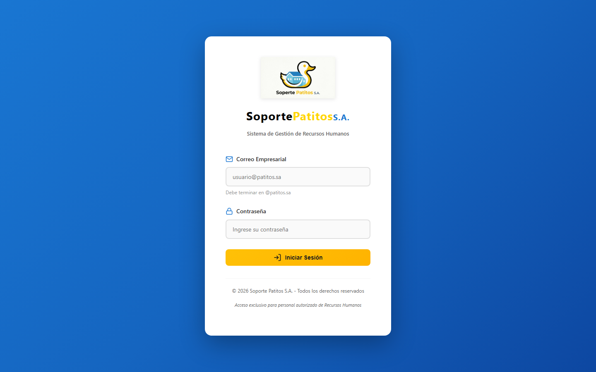
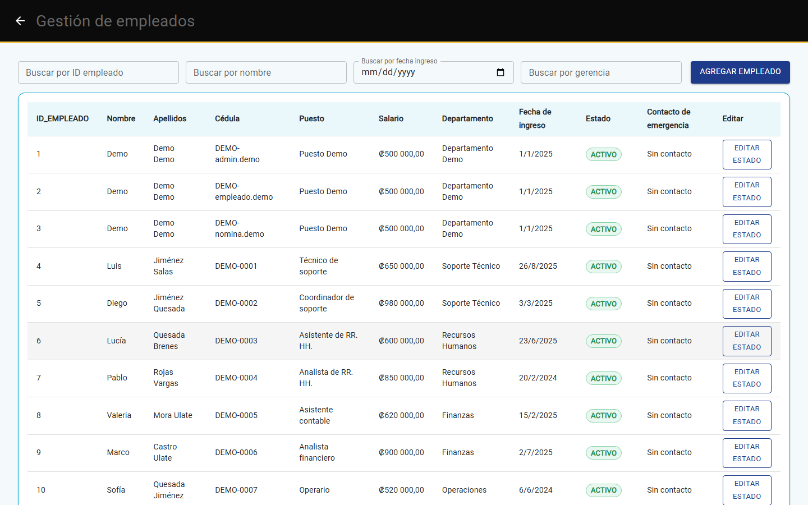
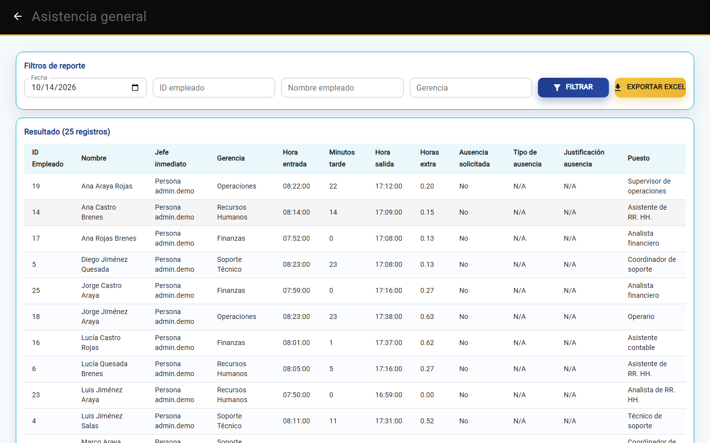
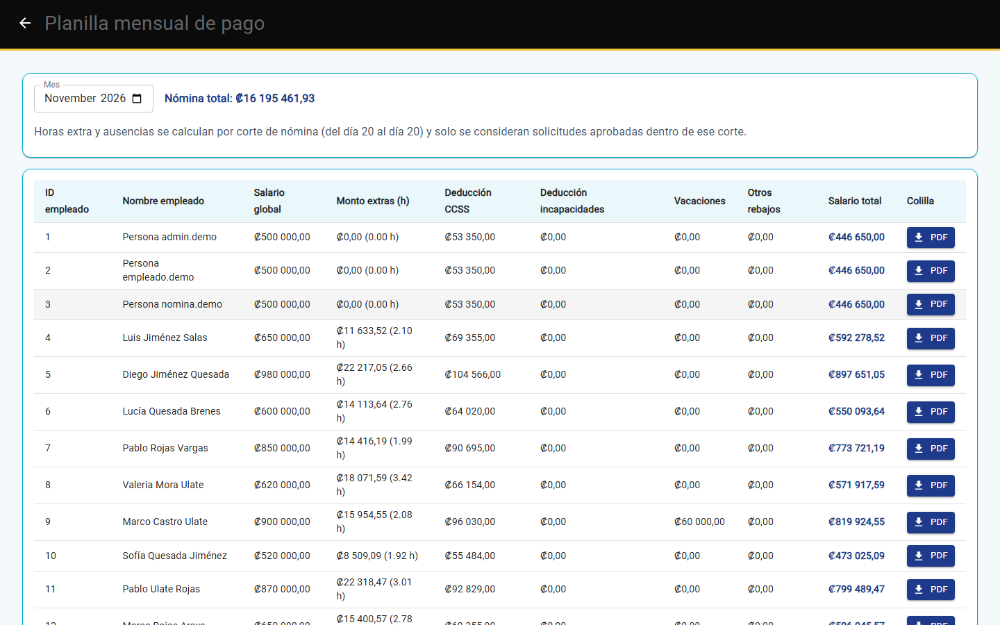
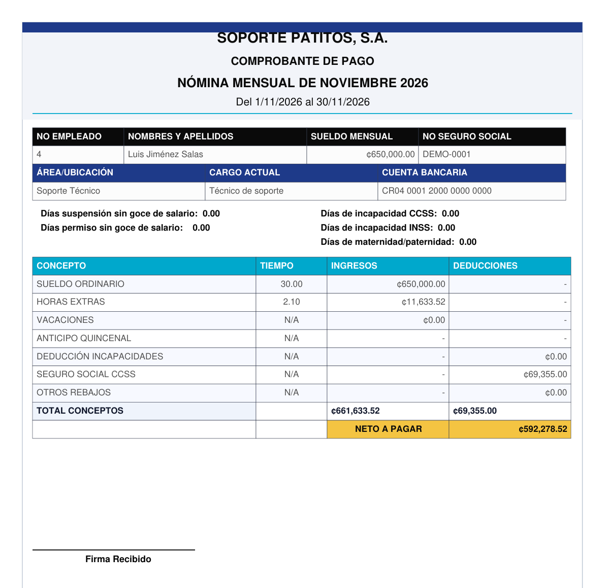

# Soporte Patitos S.A.

**Caso de estudio:** [en español](https://eduardoleo.github.io/proyectos/soporte-patitos/) · [in English](https://eduardoleo.github.io/en/projects/soporte-patitos/)

Sistema web de recursos humanos y nómina para una empresa ficticia: empleados,
asistencia (reloj web), solicitudes de ausencia, evaluaciones de desempeño,
planillas y colillas de pago. Proyecto académico de la UIA (2026).

> No es una aplicación en producción ni tiene validez fiscal o laboral. No hay
> demo pública: se ejecuta en local contra una base de datos demo con datos
> ficticios.

## Problema

Una empresa pequeña lleva asistencia, ausencias, evaluaciones y nómina en hojas
y correos separados. Eso dificulta saber quién puede ver qué (los salarios son
datos sensibles), deja cálculos de nómina en manos de cada persona y no deja un
registro consistente de lo que se aprobó.

## Solución

- Un único sistema con inicio de sesión y roles: administración, nómina/RR. HH.
  y empleado. Cada rol ve solo lo que le corresponde.
- El empleado marca entrada, almuerzo y salida, pide ausencias o cambios de
  horario y consulta sus colillas.
- Nómina genera planillas y colillas. **El servidor calcula el neto** a partir
  del salario del puesto y rechaza netos enviados por el cliente, importes
  negativos y deducciones que superen el salario.
- Reportes de asistencia y ausencias, exportación a Excel y colillas o
  evaluaciones en PDF desde el navegador.

## Arquitectura

```text
 Navegador
 ┌───────────────────────────────┐
 │ React 19 + MUI 7 (Vite)       │  JWT en cabecera Authorization
 │ SoportePatitosS.A/ClientApp   │────────────────────┐
 └───────────────────────────────┘                    │ /api (proxy de Vite en desarrollo)
                                                      ▼
 ┌──────────────────────────────────────────────────────────────┐
 │ API ASP.NET Core 10  (SoportePatitosS.A)                     │
 │  Presentation/Controllers · Security/AccessRules · Health    │
 │  JwtBearer + políticas "Administracion" y "Nomina"           │
 └──────────────┬───────────────────────────────────────────────┘
                ▼
 ┌──────────────────────────────┐   ┌──────────────────────────┐
 │ BL: reglas de negocio        │──▶│ DA: EF Core 10           │──▶ SQL Server
 │ cálculo de colillas, hashing,│   │ AppDbContext, consultas  │   (base demo local)
 │ emisión de JWT               │   └──────────────────────────┘
 └──────────────────────────────┘
        Model: entidades y contratos (requests/responses) compartidos
        Verification: ejecutable de comprobaciones (sin SQL y con SQL)
```

## Stack

| Capa | Tecnología (versiones del repositorio) |
|---|---|
| Backend | .NET 10 LTS (`net10.0`), ASP.NET Core 10, `Microsoft.AspNetCore.Authentication.JwtBearer` 10.0.15, `System.IdentityModel.Tokens.Jwt` 8.23.0, Swashbuckle 10.3.1 |
| Datos | Entity Framework Core 10.0.15, `Microsoft.Data.SqlClient` 6.1.8, SQL Server local |
| Frontend | React 19.2, Material UI 7.3, React Router 7.18, Axios 1.21, jwt-decode 4 |
| Exportaciones | jsPDF 4.2 + jspdf-autotable 5.0 (PDF), ExcelJS 4.4 (Excel, carga bajo demanda) |
| Herramientas | Vite 8.3, Vitest 5.1 + Testing Library, ESLint 10, GitHub Actions |
| Verificación | Ejecutable .NET `Verification` y scripts de PowerShell/Python en `Scripts/` |

## Seguridad aplicada

Desarrollo seguro por diseño y hardening básico; no es una auditoría.

- **Autorización en la API, no solo en la interfaz.** La política por defecto
  (`FallbackPolicy`) exige un usuario autenticado en todos los endpoints; solo el
  login y los health checks son anónimos. Las acciones de administración y nómina usan las
  políticas `Administracion` y `Nomina`. `AccessRules` compara roles exactos (sin
  aceptar subcadenas) y las colillas validan propiedad: un empleado solo ve las
  suyas.
- **Contraseñas con `PasswordHasher` de ASP.NET Core Identity (PBKDF2).** Los
  hashes heredados SHA-256/Base64 se siguen aceptando; se comparan en tiempo
  constante (`CryptographicOperations.FixedTimeEquals`) y se migran al formato
  nuevo solo después de un login válido. El hash nunca se serializa en las
  respuestas.
- **Secretos fuera del repositorio.** La cadena de conexión y `Jwt:Secret` viven en
  user-secrets. La API no arranca si `Jwt:Secret` tiene menos de 32 bytes. En
  Development solo acepta SQL Server local (`localhost`, `.` o `127.0.0.1`) con
  autenticación de Windows y la base `SoportePatitos_Portafolio_Demo`, sin
  usuarios ni contraseñas de SQL.
- **JWT validado por completo:** emisor, audiencia, firma y expiración, con
  `ClockSkew = 0`.
- **Errores públicos genéricos.** Planillas y colillas devuelven 400 solo para
  validaciones de negocio explícitas, 404 si el recurso no existe y 500 con un
  mensaje estable ante fallos inesperados, sin mensajes de SQL ni trazas.
- **Datos ficticios.** La base demo se crea con usuarios ficticios y contraseñas
  que escribe el operador (ver [datos ficticios](docs/datos-ficticios.md)).
- **Dependencias al día:** `dotnet list package --vulnerable --include-transitive`
  sin hallazgos y `npm audit` con 0 vulnerabilidades (18-11-2026).

## Cómo ejecutarlo en local

Requisitos: **.NET 10 SDK**, **Node.js 20.19+** (probado con 26) y npm, **SQL
Server local** con autenticación de Windows y Python 3 para los scripts de
verificación opcionales. Ejecutar los comandos desde la raíz del repositorio.

1. Restaurar el backend:

   ```powershell
   dotnet restore Verification/Verification.csproj
   $proyecto = 'SoportePatitosS.A/SoportePatitosS.A.csproj'
   ```

2. Guardar la conexión en user-secrets. Usar exclusivamente esta base demo:

   ```powershell
   dotnet user-secrets set 'ConnectionStrings:DefaultConnection' 'Server=localhost;Database=SoportePatitos_Portafolio_Demo;Integrated Security=True;TrustServerCertificate=True' --project $proyecto
   ```

3. Generar `Jwt:Secret` si todavía no existe. El script conserva los valores
   existentes y, si falta la clave, genera 64 bytes aleatorios y los guarda en
   user-secrets sin imprimirlos ni escribirlos en archivos del proyecto:

   ```powershell
   ./Scripts/configurar-local.ps1
   ```

   User-secrets se guarda fuera del repositorio, pero no está cifrado: no copies
   sus valores en documentación ni commits. `appsettings.Example.json` es solo
   una referencia y no se carga. Las variables de entorno y los argumentos tienen
   prioridad, así que conviene quitar overrides antiguos antes de arrancar.

4. Crear la base demo **solo si no existe** (si ya existe, la herramienta la
   rechaza y no se toca):

   ```powershell
   dotnet run --project Verification/Verification.csproj -c Release -- --create-demo
   ```

   Pide tres contraseñas ficticias por entrada oculta y crea las cuentas
   `admin.demo@patitos.sa`, `empleado.demo@patitos.sa` y `nomina.demo@patitos.sa`.
   No imprime ni guarda las contraseñas, y no hay restablecimiento automático.
   También genera 24 empleados ficticios (bloqueados), su asistencia y la
   estructura organizacional.
   Los SQL de `ArchivoSQL/` son históricos y no forman parte del arranque.

5. Iniciar la API:

   ```powershell
   $env:ASPNETCORE_ENVIRONMENT = 'Development'
   $env:ASPNETCORE_HOSTINGSTARTUPASSEMBLIES = ''
   dotnet run --project $proyecto --no-launch-profile -- --urls http://localhost:5067
   ```

6. Iniciar el frontend en otra terminal:

   ```powershell
   cd SoportePatitosS.A/ClientApp
   npm ci
   npm start
   ```

   Abrir `http://localhost:3000`. Vite redirige `/api` y `/health` a
   `http://localhost:5067`. Swagger está en `http://localhost:5067/swagger` (solo
   en Development). `/health/live` comprueba el proceso y `/health/ready`, la
   conexión y las columnas mapeadas.

### Variables de entorno del frontend

El cliente pasó de Create React App a Vite. Solo las variables con prefijo
`VITE_` llegan al código (antes `REACT_APP_*`) y se leen con `import.meta.env`.
Hoy solo se usa una, en la configuración de Vite:

| Variable | Valor por defecto | Uso |
|---|---|---|
| `VITE_API_PROXY_TARGET` | `http://localhost:5067` | Destino del proxy de desarrollo para `/api` y `/health` |

Para cambiarla, copiar `ClientApp/.env.example` a `ClientApp/.env.local`, que
git ignora. El puerto 3000 se mantiene porque lo esperan `SpaProxy` y la
política CORS de la API.

## Verificaciones

**Sin SQL ni secretos** (es lo que ejecuta el CI en cada PR a `main`):

```powershell
dotnet run --project Verification/Verification.csproj -c Release
```

Es un ejecutable que termina con error si falla alguna comprobación, no una
suite con cobertura exhaustiva. Incluye 29 comprobaciones base (hashing y
migración desde SHA-256, que el hash no aparezca en el JSON, roles exactos,
permisos de planillas, cambio de clave propia o ajena e identidad anónima, y
equivalencia del reporte de asistencia indexado en memoria), además de los
módulos de autorización de colillas, consistencia aritmética de colillas, reglas
de negocio de nómina y errores públicos.

**Frontend**, desde `SoportePatitosS.A/ClientApp`:

```powershell
npm test         # Vitest: login (3 casos) y exportación a Excel
npm run lint     # ESLint sin advertencias permitidas
npm run build    # build de producción en build/
```

**Con SQL Server local y user-secrets** (ejecutadas el 19-11-2026 con SQL Server
2022 Express y una base creada con `--create-demo`; todas terminaron con código 0):

```powershell
dotnet build Verification/Verification.csproj -c Release
python Scripts/verificar-user-secrets.py
python Scripts/verificar-colillas-permisos.py
./Scripts/verificar-api.ps1
dotnet run --project Verification/Verification.csproj -c Release -- --verify-colilla-demo
dotnet run --project Verification/Verification.csproj -c Release -- --verify-demo-provisioning
```

- `--verify-colilla-demo` crea una colilla mediante BL/DA, relee el cálculo
  guardado, revierte la transacción y comprueba que no quedan filas.
- `verificar-colillas-permisos.py` prueba por HTTP real 401/403, los roles de
  nómina y administración, IDs ajenos, claims inválidos y tokens expirados.
- `--verify-demo-provisioning` crea tres cuentas temporales, prueba login y
  permisos por HTTP (96 comprobaciones) y borra solo esas filas.

El detalle de cada verificación está en la [revisión técnica](docs/revision-tecnica.md)
y en [endpoints verificados](ENDPOINTS_VERIFICADOS.md).

## Capturas

Tomadas en local el 19-11-2026 sobre la base demo. Todos los nombres, cédulas,
cuentas y montos son ficticios.

| | |
|---|---|
|  |  |
| Inicio de sesión | Gestión de empleados |
|  |  |
| Asistencia general (14-10-2026) | Planilla mensual (noviembre de 2026) |
|  | |
| Colilla en PDF generada por la aplicación | |

**Estructura organizacional:** los reportes de asistencia, empleados y
evaluaciones leen la tabla `Estructura_Organizacional`, que no forma parte del
modelo de EF Core. `--create-demo` la crea y la llena con una jerarquía ficticia:
el administrador demo es gerente general, cada departamento tiene un jefe de área
y el resto del personal le reporta. Así "Asistencia general" muestra a todo el
personal activo en una base demo nueva, sin pasos manuales.

## Mi contribución

Proyecto desarrollado por un equipo de 3 estudiantes de la UIA (2026).

Mi contribución: "Full Back end y basde de datos, front End apoyo en correciones".

Esta copia es mi repositorio personal de trabajo. El código del equipo conserva
su autoría original.

## Lo que aprendí

- **Migrar hashes de contraseña sin forzar un restablecimiento:** aceptar el
  formato SHA-256 heredado, compararlo en tiempo constante y volver a hashearlo
  con PBKDF2 solo cuando el login es válido.
- **Denegar por defecto:** con una `FallbackPolicy` autenticada, un endpoint
  nuevo sin atributos queda protegido. Comparar roles exactos evita que
  "ANALISTA" cuente como "ANALISTA DE NÓMINA".
- **No confiar en el cliente para el dinero:** el neto de la colilla se calcula en
  el servidor con el salario del puesto, y las entradas inválidas se rechazan sin
  escribir nada.
- **Fallar al arrancar si la configuración es insegura:** una clave JWT corta o
  una cadena de conexión que no sea la base demo local detienen la API antes de
  atender peticiones.
- **Mantener las dependencias al día:** migrar de .NET 8 (sin soporte desde el
  10-11-2026) a .NET 10, y de Create React App a Vite, dejó en 0 las
  vulnerabilidades conocidas de NuGet y npm (npm reportaba 60, la mayoría de
  `react-scripts`). Para `xlsx`, que no tiene corrección en npm, hubo que
  cambiar de biblioteca.

## Limitaciones conocidas

- Quedan 375 advertencias de nulabilidad (CS86xx) en el backend. Compila sin
  errores, pero falta anotar o corregir esos tipos.
- Las verificaciones con SQL Server, la creación del esquema de una base nueva y
  la entrada oculta de contraseñas no se ejecutaron en la última revisión.
- Las pruebas de permisos cubren planillas y colillas; no certifican los permisos
  de todos los demás módulos.
- El JWT se guarda en `localStorage`. Es habitual en SPAs, pero lo expone ante
  XSS; una cookie `HttpOnly` sería más robusta.
- Los rebajos (CCSS, incapacidades, renta) se basan en conceptos de Costa Rica,
  pero el sistema los recibe como datos: no calcula tarifas legales.
  `Planillas.jsx` muestra una vista previa calculada en el navegador,
  independiente de la colilla guardada; `RegistrosDocumentos.jsx` usa los
  valores persistidos.
- El bundle principal del frontend pesa cerca de 1,3 MB sin comprimir (383 kB
  con gzip); falta dividirlo por rutas.
- Varios efectos de React desactivan `react-hooks/exhaustive-deps` con un
  comentario para conservar el comportamiento original; convendría
  reestructurarlos con `useCallback`.
- El historial de git conserva versiones antiguas de las semillas SQL. Antes de
  publicar el repositorio hay que limpiarlo o crear un historial nuevo.

## Licencia

© 2026 Eduardo León Hernández. Todos los derechos reservados (ver [LICENSE](LICENSE)).
El código se publica como muestra de trabajo: se puede ver y evaluar, pero no copiar,
modificar, distribuir ni reutilizar sin permiso escrito.
